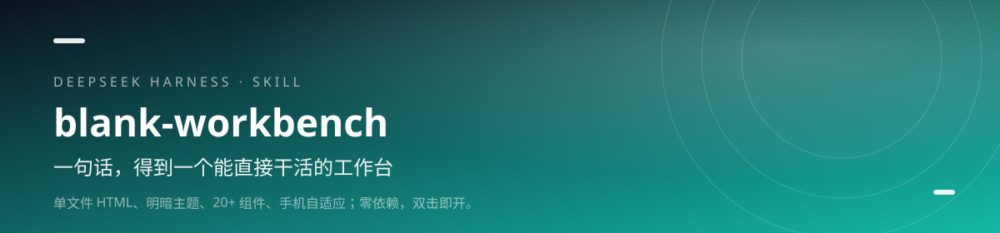

<div align="center">



<h1>blank-workbench · 空白工作台</h1>

<p><b>一句话，得到一个能直接干活的工作台。</b></p>

<p>单文件 HTML、明暗主题、20+ 组件、手机自适应；零依赖，双击即开。</p>

[](https://github.com/lilinshuei/blank-workbench/actions/workflows/validate.yml)
[](LICENSE)
[](https://www.npmjs.com/package/blank-workbench)
[](https://github.com/topics/dsh-plugin)
[](#环境要求)

</div>

---

## 它解决什么问题

每开一个新项目，都要重新搭一遍顶栏、侧栏、主题、表格、空状态。看起来是小事，实际最消耗开工的劲。

这个 Skill 直接给你一个通用基座：单文件、零外部依赖、明暗主题、20+ 常用组件，PC 是侧栏，手机自动变横向 tab。你只需要往里填业务模块。

## 你会得到什么

- **单文件交付** — HTML、CSS、JS 全内联，双击就开；发给别人不会出现“样式没加载”。
- **20+ 通用组件** — 卡片、统计、标签、表格、折叠、按钮、空状态、工具条，复制即可用。
- **明暗主题** — 全部颜色走 CSS 变量，切换即时生效，并用 localStorage 记住选择。
- **响应式外壳** — PC 顶栏 + 侧栏，≤820px 自动切成横向滚动 tab，不横向溢出。
- **参数化生成** — 标题、模块名、主题色都能用命令行一次传入，默认产出一份可用的概览页。

## 安装

### npm 一行安装（推荐）

```powershell
dsh plugin --profile web add blank-workbench
```

包已发布到 npm registry，命令最短，也不依赖 GitHub 访问。桌面端把 `web` 换成 `desktop`；装完重启 DSH，新会话即可调用。

### 从 GitHub 安装

```powershell
dsh plugin --profile web add github:lilinshuei/blank-workbench
```

想跟最新提交，或 npm 拉取不畅时用这条。

### 手动安装

```bash
git clone https://github.com/lilinshuei/blank-workbench.git
mkdir -p ~/.dsh/skills
cp -r blank-workbench ~/.dsh/skills/
```

最终路径是 `~/.dsh/skills/blank-workbench/SKILL.md`。仓库根目录就是 Skill 本体，不用再找子目录。

## 快速上手

### 1. 生成一份工作台

```bash
node scaffold.cjs --title "我的项目看板" --nav "概览,任务,成员,报表" --accent "#10b981" --out "项目看板.html"
```

第一项自动映射到带完整组件示范的“概览”，其余模块是空占位。

### 2. 打开看看

```bash
start "" "项目看板.html"
```

确认主题切换、导航显隐、手机宽度下没有横向滚动。

### 3. 填业务

```html
<!-- 复制 .card / .stat / .table 到对应 .view 里 -->
```

不要引入 CDN；这个基座的底线是离线可用。

## 能力边界

- 它是骨架，不是现成业务系统；模块内容需要你按需填。
- 默认不引图表库；要图表请自行引入，并接受联网或本地打包的代价。
- 不提供后端、账号、权限与数据存储。

## 环境要求

| 项 | 要求 |
|---|---|
| 生成器 | Node.js（任意近两年版本） |
| 查看产物 | 任意现代浏览器 |
| 外部依赖 | 零；不需要联网 |

## 仓库里有什么

```
blank-workbench/
├── template.html
├── scaffold.cjs
├── SKILL.md
├── lib/index.js          # DSH 插件适配层（零依赖）
├── cordis.patch.yml      # DSH 挂载声明
├── tools/                # 仓库自检 + 适配层冒烟测试
└── README.md
```

- template.html — 打开即用的完整骨架
- scaffold.cjs — 参数化生成器
- SKILL.md — 组件清单、扩展步骤、踩坑说明

## 安全与隐私

- **零遥测**：不上报使用数据、不内置统计、不访问外部接口。
- **本地执行**：所有处理都在你的机器上完成；需要联网时只发生在你自己执行的包管理器或下载命令里。
- **不删文件**：仓库脚本以“只新增、不删除”为约束；需要清理时会先说明并留回退路径。
- **无凭据**：仓库不包含账号、令牌、Cookie 或本机绝对路径。发现问题请按 [SECURITY.md](SECURITY.md) 私下报告。

## 同系列 Skill

| Skill | 一句话 |
|---|---|
| **[novel-atlas](https://github.com/lilinshuei/novel-atlas)** | 把一本小说，变成一座可以走进去的世界。 |
| **[pc-privacy-shield](https://github.com/lilinshuei/pc-privacy-shield)** | 你的屏幕看得见，别人的截屏看不见。 |
| **[task-complete-chime](https://github.com/lilinshuei/task-complete-chime)** | 任务跑完了，别再盯着屏幕等。 |
| **[phone-media-transfer-android-app](https://github.com/lilinshuei/phone-media-transfer-android-app)** | App 说找不到文件夹？那就从电脑直接送进去。 |
| **[source-to-app](https://github.com/lilinshuei/source-to-app)** | 源码到双击即用，只差这一条命令。 |

## License

MIT © 2026 lilinshuei。本 Skill 为原创设计；第三方依赖与素材在各自目录内单独标注。

---

如果它替你省下了时间，点一个 **Star**，让更多人找到它。
